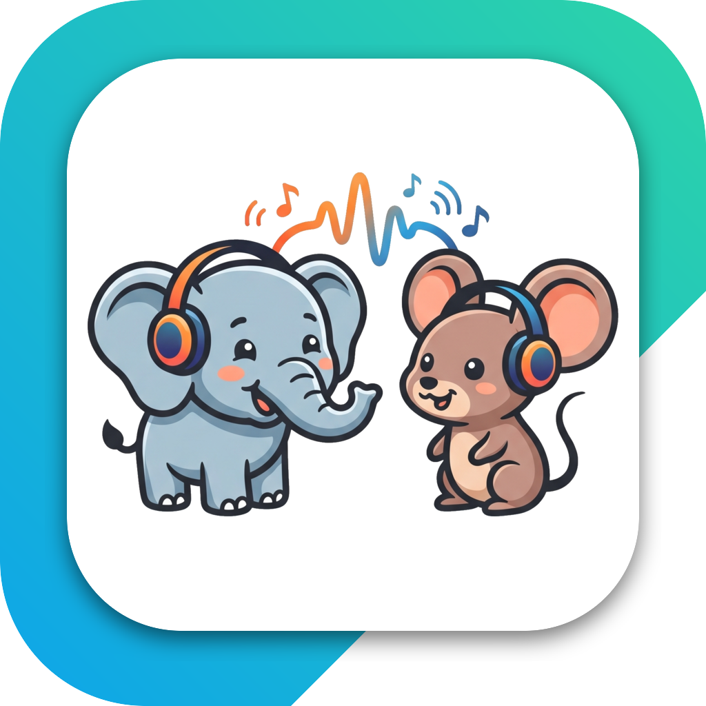

<div align="center">
  
  <h1>hearken</h1>
  <p>Low-latency system-audio bridge between a Mac and a Windows PC.</p>
</div>

hearken plays the system audio of one computer on another in real time, in either direction or both at once. It works between a Mac host and a Windows client; Mac-to-Mac and Windows-to-Windows are not implemented. It runs as a menubar or tray app built with Go and [Wails](https://wails.io).

hearken has no authentication or encryption. It sends raw PCM audio over plain TCP on ports 45000 and 45001, and the Mac host listens on all network interfaces, so anyone who can reach those ports can hear the stream or send audio into it. Use it only over [Tailscale](https://tailscale.com) or a LAN you trust, and never expose the ports to the internet. The only bind option is `HEARKEN_PLAY_BIND_IP`, described under [Networking](#networking).

## Install

The install scripts build from this checkout and need Go 1.23 or later, Node, and Wails v2.12.0 (`go install github.com/wailsapp/wails/v2/cmd/wails@v2.12.0`).

On the Mac (host), with Homebrew and the Xcode command-line tools installed:

```bash
bash install/install-mac.sh
```

This installs ffmpeg and BlackHole 2ch, builds `hearken.app` and its audio helpers, signs the app with a self-signed certificate so the microphone permission survives rebuilds, copies it to `/Applications`, and loads a login agent. Then click the menubar icon, choose **Open hearken**, and allow the microphone prompt once.

On Windows (client), which needs .NET Framework 4.x (included with Windows 10 and 11):

```powershell
powershell -ExecutionPolicy Bypass -File install\install-windows.ps1
```

This builds `hearken.exe` and its audio helpers, registers a logon task, and adds Start menu and Installed apps entries. Running it with `-Uninstall` removes the task and entries.

The prebuilt apps on the [Releases](https://github.com/smkwray/hearken/releases) page are older than this code and lack `HEARKEN_PLAY_BIND_IP`. To use one, put it in `build/bin/` before running the install script. The macOS download is not notarized, so right-click it and choose **Open** the first time.

## Use

1. Click the menubar or tray icon and choose **Open hearken**. On macOS, opening hearken from Spotlight, Raycast or Launchpad brings up the same window.
2. Leave the role on **Auto**, which makes the Mac the host (it listens) and Windows the client (it connects).
3. On the client, press **Scan** to find hosts on your Tailscale network or LAN, or type the address the host shows under "Others reach this device at", then press **Save**.
4. Choose the same direction on both machines: **Host→Client** (Mac audio on Windows), **Client→Host** (Windows audio on the Mac) or **Both**, and set the volume.
5. Close the window. hearken keeps running, and the client reconnects at every login while "Start bridge automatically on launch" is on (the default). **Quit hearken** in the icon menu stops the bridge.

When the Mac sends audio, hearken switches its output to a multi-output device named Bridge Out, which plays through your current output and feeds BlackHole for capture. Windows audio plays on the Mac's selected output with **Client→Host**, and on its built-in headphones or speakers with **Both**. Windows playback follows the default output device, including Bluetooth headphones that connect later.

## Networking

Port 45000 carries the host's audio and port 45001 carries the client's, as 48 kHz 16-bit stereo. Over Tailscale, use the host's `100.x` address. On a plain LAN, use its LAN address and allow both ports through the Mac's firewall.

When a Mac host only receives audio (**Client→Host**), setting `HEARKEN_PLAY_BIND_IP` to one of its IPv4 addresses, such as its Tailscale address, makes port 45001 listen only there. Add it under `EnvironmentVariables` in `~/Library/LaunchAgents/com.hearken.daemon.plist`; the install script rewrites that file when run again. In the other directions both ports listen on all interfaces.

## Limitations

- After a network stall, Mac-to-Windows audio skips ahead: the Mac queues at most about half a second and drops older audio, and the Windows player trims a late burst back to its normal buffer. Windows-to-Mac audio is not trimmed, so a stall makes it play late.
- Bluetooth headphones add their own latency, which hearken cannot measure. Use a wired output if latency matters.

## Troubleshooting

- Windows hears nothing although both sides show as connected: the Mac host probably lacks microphone permission and is sending silence. Grant it in System Settings → Privacy & Security → Microphone.
- Crackles or dropouts: press **Mark glitch** when you hear one. It marks the moment in the log (`~/Library/Application Support/hearken/hearken.log` on macOS, `%APPDATA%\hearken\hearken.log` on Windows) beside the sender and receiver measurements.

## Dependencies and licenses

The macOS dependencies are installed, not bundled. `NAudio.dll` is included in this repository and in the Windows release archive.

| Dependency | Used for | License |
|---|---|---|
| [BlackHole 2ch](https://existential.audio/blackhole/) | macOS system-audio capture | GPL-3.0 |
| [ffmpeg](https://ffmpeg.org) | macOS playback | LGPL/GPL |
| [NAudio](https://github.com/naudio/NAudio) | Windows capture and playback | MIT |
| [Wails](https://wails.io) | app shell | MIT |
| [Tailscale](https://tailscale.com) (optional) | network transport | BSD-3-Clause |

## License

MIT. See [LICENSE](LICENSE).
